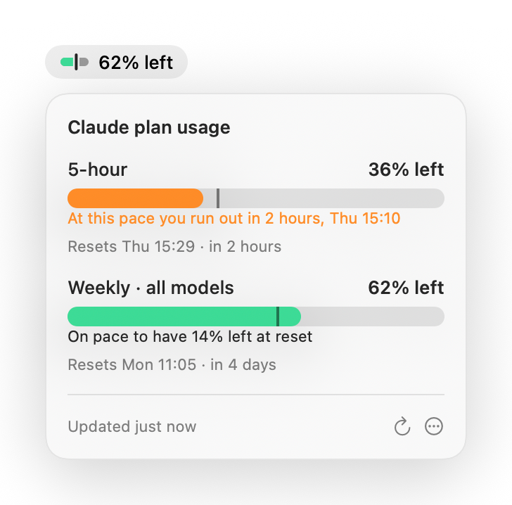

<p align="center">
  <picture>
    <source media="(prefers-color-scheme: dark)" srcset="assets/logo-dark.png">
    
  </picture>
</p>

<p align="center">
  <b>Will your Claude plan last the week?</b><br>
  Plan limits, pace and run-out time, in your Mac's menu bar.
</p>

<p align="center">
  <picture>
    <source media="(prefers-color-scheme: dark)" srcset="assets/screenshot-dark.png">
    
  </picture>
</p>

> [!NOTE]
> QuotaBar is an unofficial, independent project. It is not affiliated with, endorsed
> by or supported by Anthropic. Claude is a trademark of Anthropic.

## Install

```bash
brew install rorydotgg/tap/quotabar
brew services start quotabar
```

The first command builds QuotaBar from source on your Mac. The second starts it now and
at every login. That's all: no signing, no Gatekeeper prompt (an app you build locally
has no quarantine flag), and nothing to redo after `brew upgrade`.

You need macOS 14 or later and the Claude Code CLI signed in with a claude.ai plan
(`claude auth login`).

## Reading the bar

Each limit gets one bar. By default it shows **what's left**, draining like a fuel gauge.

- **The fill** is how much of the limit you have left.
- **The tick** is where an even pace would leave you right now.
- **Fill past the tick** (mint): you're on pace. It shows how much you'll have left at reset.
- **Fill short of the tick** (orange): you're ahead of pace. It shows when you'd run out.
- **Red**: 90% or more used.

The menu bar glyph is the same bar, live and in the same colours, for whichever limit is
closest to running out.
Switch to showing usage instead under `⋯` → **Show remaining**.

Accounts without a 5-hour limit show their weekly limits only.

## Privacy

- QuotaBar reads Claude Code's sign-in from your keychain (`Claude Code-credentials`)
  and sends it only to `api.anthropic.com`.
- It never stores, logs or refreshes the token itself. When the token has expired it
  runs `claude auth status`, which renews it without using any of your plan.
- No analytics, no other network calls.

## How it works

- Every 5 minutes it calls `GET https://api.anthropic.com/api/oauth/usage`
  (header `anthropic-beta: oauth-2025-04-20`). This endpoint is undocumented and can
  change without notice.
- On HTTP 429 it doubles the wait, up to 30 minutes, and keeps showing the last reading.
- Readings and back-off state are saved (`defaults read local.quotabar`), so a relaunch
  shows the last numbers without calling the endpoint.
- Projections are linear: your average pace since the window opened, carried to the
  reset. Expect them to be jumpy in the first day of a weekly window.
- Homebrew installs start at login through `brew services`, which uses the stable
  `opt` path. After `brew upgrade` deletes the old version, QuotaBar notices within
  30 seconds and restarts itself on the new one. It also keeps a Finder alias at
  `~/Applications/QuotaBar.app` so Spotlight and Raycast can find it.

## Uninstall

```bash
brew services stop quotabar
pkill -x QuotaBar
brew uninstall quotabar
brew untap rorydotgg/tap
trash ~/Applications/QuotaBar.app
defaults delete local.quotabar
```

## Build from source

```bash
./build.sh
open QuotaBar.app
```

One Swift file, no dependencies. `./test.sh` runs the response-parsing checks plus one
live call. Avoid Swift macros (including `@State`): their plugins fail to load inside
Homebrew's build environment.

`./branding/render.sh` regenerates the icon, logos, screenshots and social preview in
`assets/` from SwiftUI code. The screenshots use the app's real views with made-up
numbers.

## Extras

- `scripts/claude-usage.sh` writes the same data as JSON to `~/.claude/usage-live.json`
  for other tools.
- `scripts/statusline-usage.sh` is a Claude Code status line that exports
  `rate_limits` while the CLI is open.
